<!-- ═══════════════ HEADER ═══════════════ -->


<div align="center">


<br/>


</div>

---

## 👨‍💻 About Me

<table>
<tr>
<td width="52%" valign="top">

```javascript
const dharmik = {
  name:     "Dharmik Ghaskata",
  role:     "Aspiring Full Stack Developer",
  location: "India 🇮🇳",
  strongAt: ["HTML", "CSS", "JavaScript"],
  learning: ["React", "Node.js", "Databases"],
  goal:     "Build & ship real-world full stack apps",
  motto:    "Code. Break. Fix. Repeat."
};
```

</td>
<td width="48%" valign="top">

- 🎯 Focused on becoming a **Full Stack Developer**
- 🌱 Learning **front end → back end → databases → deployment**
- 🛠️ Building projects to practice what I learn
- 🤝 Open to **internships, collaboration & open source**
- 📫 Reach me via the **Let's Connect** section below

</td>
</tr>
</table>

---

## 🛠️ Tech Stack

<table align="center">
<tr>
  <td align="center" width="180"><b>✅ Solid Foundation</b></td>
  <td></td>
</tr>
<tr>
  <td align="center"><b>🌱 Currently Learning</b></td>
  <td></td>
</tr>
<tr>
  <td align="center"><b>🧰 Tools & Workflow</b></td>
  <td></td>
</tr>
<tr>
  <td align="center"><b>📘 Also Explored</b></td>
  <td></td>
</tr>
</table>

---

## 🗺️ Full Stack Roadmap

```mermaid
flowchart LR
    A["HTML & CSS"] --> B["JavaScript"]
    B --> C["Git & GitHub"]
    C --> D["React"]
    D --> E["Node.js & Express"]
    E --> F["Database"]
    F --> G["REST APIs & Auth"]
    G --> H["Deployment"]

    classDef done fill:#0072ff,stroke:#00c6ff,color:#fff
    classDef doing fill:#7b2ff7,stroke:#c9a0ff,color:#fff
    classDef todo fill:#2b2f3a,stroke:#555,color:#bbb
    class A,B,C done
    class D,E doing
    class F,G,H todo
```



> 🟦 Done &nbsp;•&nbsp; 🟪 In progress &nbsp;•&nbsp; ⬛ Up next

---

## 🚀 Projects

| Project | What it is | Built with |
|---|---|---|
| 🚗 [**EliteMotors**](https://github.com/dharmikghaskata/EliteMotors) | Car dealership platform connecting buyers and sellers, with browse, search and purchase flow | `Web App` |
| 💼 [**Portfolio**](https://github.com/dharmikghaskata/portfolio) | Responsive personal portfolio to showcase my skills, projects and web work | `HTML` `CSS` |
| 🙋 [**Dharmik Profile**](https://github.com/dharmikghaskata/dharmik-profile) | Personal landing page with GitHub and LinkedIn links | `HTML` |
| 🌧️ [**Rainfall Data Analysis**](https://github.com/dharmikghaskata/Rainfall_Data_Analysis) | Analysis of monthly and annual rainfall patterns, regional variation and outliers | `Python` |

---

## 📊 GitHub Stats

<div align="center">


</div>

---

## 🐍 Contribution Snake

<div align="center">
<picture>
  <source media="(prefers-color-scheme: dark)" srcset="https://raw.githubusercontent.com/dharmikghaskata/dharmikghaskata/output/github-snake-dark.svg"/>
  <source media="(prefers-color-scheme: light)" srcset="https://raw.githubusercontent.com/dharmikghaskata/dharmikghaskata/output/github-snake.svg"/>
  
</picture>
</div>

---

## 🎯 What I'm Working On

```text
🔄  Learning React and building component-based UIs
🔄  Learning Node.js & Express for the back end
🔜  Databases, REST APIs and authentication
🔜  Building and deploying a complete full stack project
```

---

## 🤝 Let's Connect

<div align="center">

<a href="https://www.linkedin.com/in/dharmik-ghaskata"></a>
<a href="mailto:ghaskatadharmik04@gmail.com"></a>
<a href="https://github.com/dharmikghaskata/portfolio"></a>

<br/><br/>


</div>


